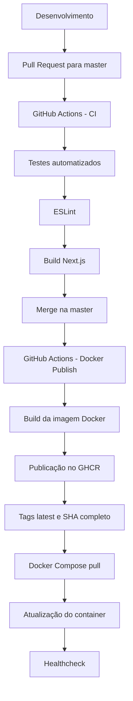

# TaskFlow

Plataforma SaaS de gerenciamento de tarefas com board Kanban, desenvolvida com Next.js, TypeScript, Prisma e Neon PostgreSQL.

O projeto também conta com uma infraestrutura de containerização e automação CI/CD utilizando Docker, Docker Compose, GitHub Actions e GitHub Container Registry (GHCR).

**Aplicação:** [taskflow-five-lime.vercel.app](https://taskflow-five-lime.vercel.app/)
**Repositório:** [github.com/CaioMiranda12/taskflow-interface](https://github.com/CaioMiranda12/taskflow-interface)


## Sobre o projeto

O TaskFlow é uma aplicação de gerenciamento de tarefas inspirada em ferramentas como Linear e Jira. Permite criar, editar, remover e organizar tarefas em um board Kanban com drag and drop, além de oferecer um dashboard com métricas e gráficos.

O projeto foi desenvolvido para praticar conceitos de desenvolvimento Full Stack e DevOps, incluindo containerização, integração contínua e publicação automatizada de imagens Docker.

## Funcionalidades

- Autenticação com JWT (registro, login e logout).
- Dashboard com métricas, gráfico de status e tarefas urgentes.
- Board Kanban com drag and drop entre colunas.
- Lista de tarefas com filtros por status.
- Criar, editar e remover tarefas.
- Página de detalhe da tarefa.
- Feedback visual com toasts.
- Layout responsivo para mobile.
- Proteção de rotas via middleware.

## Tecnologias

### Frontend

- [Next.js 15](https://nextjs.org/) — framework React com App Router.
- [TypeScript](https://www.typescriptlang.org/) — tipagem estática.
- [Tailwind CSS 4](https://tailwindcss.com/) — estilização.
- [Zustand](https://zustand-demo.pmnd.rs/) — estado global.
- [TanStack Query](https://tanstack.com/query) — cache e sincronização de dados.
- [Axios](https://axios-http.com/) — cliente HTTP.
- [React Hook Form](https://react-hook-form.com/) + [Zod](https://zod.dev/) — formulários e validação.
- [@dnd-kit](https://dndkit.com/) — drag and drop.
- [Recharts](https://recharts.org/) — gráficos.
- [Sonner](https://sonner.emilkowal.ski/) — toasts.
- [React Icons](https://react-icons.github.io/react-icons/) — ícones.

### Backend

- [Next.js Route Handlers](https://nextjs.org/docs/app/building-your-application/routing/route-handlers) — endpoints REST.
- [Prisma 7](https://www.prisma.io/) — ORM.
- [Neon](https://neon.tech/) — PostgreSQL serverless.
- [bcrypt](https://github.com/dcodeIO/bcrypt) — hash de senhas.
- [jsonwebtoken](https://github.com/auth0/node-jsonwebtoken) — autenticação JWT.

### DevOps e infraestrutura

- [Docker](https://www.docker.com/) — containerização da aplicação.
- [Docker Compose](https://docs.docker.com/compose/) — gerenciamento do container.
- Dockerfile multi-stage — separação das etapas de dependências, build e execução.
- [GitHub Actions](https://github.com/features/actions) — automação de CI/CD.
- [GitHub Container Registry](https://ghcr.io/) — armazenamento e distribuição das imagens Docker.
- Docker Healthcheck — monitoramento da disponibilidade HTTP do container.

## Arquitetura

### Aplicação

```text
src/
├── app/
│   ├── (auth)/         # Páginas públicas (login, register)
│   ├── (private)/      # Páginas protegidas (dashboard, board, tasks)
│   └── api/            # Route Handlers (auth, tasks)
├── components/         # Componentes reutilizáveis
├── features/           # Módulos por funcionalidade
├── hooks/              # Custom hooks
├── services/           # Chamadas HTTP com Axios
├── stores/             # Estado global com Zustand
├── schemas/            # Schemas de validação com Zod
├── types/              # Interfaces e tipos TypeScript
├── constants/          # Valores fixos da aplicação
├── data/               # Dados mockados
└── utils/              # Funções utilitárias
```

### Fluxo de CI/CD



## Executando localmente

### Pré-requisitos

- [Node.js 22](https://nodejs.org/).
- npm.
- Conta e banco PostgreSQL no [Neon](https://neon.tech/).

### 1. Clone o repositório

```bash
git clone https://github.com/CaioMiranda12/taskflow-interface.git

cd taskflow-interface
```

### 2. Instale as dependências

```bash
npm ci
```

### 3. Configure as variáveis de ambiente

Copie o arquivo de exemplo:

```bash
cp .env.example .env
```

Configure as variáveis no arquivo `.env`:

| Variável | Descrição |
|---|---|
| `DATABASE_URL` | String de conexão com o banco PostgreSQL no Neon. |
| `JWT_SECRET` | Chave privada utilizada na assinatura dos tokens JWT. |

Utilize os dados do seu próprio banco e uma chave JWT segura. Nunca compartilhe ou versione o arquivo `.env`.

### 4. Configure o banco de dados

Gere o Prisma Client:

```bash
npx prisma generate
```

Aplique as migrations existentes:

```bash
npx prisma migrate deploy
```

### 5. Inicie a aplicação

```bash
npm run dev
```

Acesse [http://localhost:3000](http://localhost:3000).

## Executando com Docker

O projeto possui um Dockerfile multi-stage que gera uma imagem otimizada para produção, utilizando o modo standalone do Next.js.

O Docker Compose permite executar a aplicação utilizando a imagem publicada no GitHub Container Registry.

### Pré-requisitos

- [Docker](https://docs.docker.com/get-docker/).
- Docker Compose.

### 1. Configure as variáveis de ambiente

Crie o arquivo `.env` utilizando o modelo:

```bash
cp .env.example .env
```

Preencha `DATABASE_URL` e `JWT_SECRET` com os valores do seu ambiente.

### 2. Baixe a imagem

```bash
docker compose pull
```

### 3. Inicie a aplicação

```bash
docker compose up -d
```

### 4. Verifique o container

```bash
docker compose ps
```

Para acompanhar os logs:

```bash
docker compose logs -f taskflow
```

Acesse [http://localhost:3000](http://localhost:3000).

### 5. Encerre a aplicação

```bash
docker compose down
```

### Healthcheck

O Docker Compose possui um Healthcheck que verifica a disponibilidade HTTP da aplicação por meio do endpoint `/login`.

Configuração utilizada:

| Parâmetro | Valor |
|---|---|
| Intervalo | 30 segundos |
| Timeout | 10 segundos |
| Tentativas | 3 |
| Start period | 20 segundos |

O teste utiliza o `fetch` nativo do Node.js e considera respostas HTTP bem-sucedidas e redirecionamentos para determinar a disponibilidade do endpoint.

O Healthcheck monitora a resposta HTTP da aplicação, mas não garante, isoladamente, a disponibilidade do banco de dados.

## CI/CD com GitHub Actions

O projeto utiliza dois workflows independentes para automatizar a validação e a publicação da aplicação.

### Continuous Integration (CI)

Arquivo: `.github/workflows/ci.yml`

O pipeline executa as seguintes etapas:

1. Checkout do código.
2. Configuração do Node.js 22.
3. Instalação das dependências com `npm ci`.
4. Execução dos testes automatizados com Jest.
5. Análise estática com ESLint.
6. Build da aplicação Next.js.

O workflow é executado em pushes nas branches configuradas e em Pull Requests direcionados à `master`.

### Continuous Delivery (CD)

Arquivo: `.github/workflows/docker-publish.yml`

Quando ocorre um push na branch `master`, o GitHub Actions:

1. Configura o Docker Buildx.
2. Realiza autenticação no GitHub Container Registry utilizando o `GITHUB_TOKEN`.
3. Gera as tags da imagem.
4. Constrói a imagem Docker.
5. Publica a imagem no GHCR.

Imagem publicada:

```text
ghcr.io/caiomiranda12/taskflow-interface
```

Tags geradas:

| Tag | Descrição |
|---|---|
| `latest` | Referência à imagem publicada mais recentemente. |
| SHA completo | Identificador da versão associado ao commit. |

A publicação automatizada disponibiliza a imagem no GHCR. A atualização de um ambiente executando Docker Compose é realizada manualmente por meio de `docker compose pull` e `docker compose up -d`.

## Testes

O projeto possui testes automatizados cobrindo a lógica principal da aplicação.

### Tecnologias

- [Jest](https://jestjs.io/) — test runner.
- [ts-jest](https://kulshekhar.github.io/ts-jest/) — suporte a TypeScript.
- [Testing Library](https://testing-library.com/) — testes de hooks React.

### Cobertura

| Arquivo | O que testa |
|---|---|
| `useTaskStore` | Actions da store (add, remove, update, updateStatus). |
| `useTaskFilter` | Lógica de filtro por status. |
| `useTaskMetrics` | Cálculo de métricas e tarefas urgentes. |
| `authSchema` | Validações de login e registro. |
| `taskSchema` | Validações do formulário de tarefas. |
| `taskService` | Chamadas HTTP (fetchTasks, createTask, updateTask, deleteTask). |

### Executar os testes

```bash
# Executar todos os testes
npm test

# Executar em modo watch
npm run test:watch
```

### Executar lint e build

```bash
npm run lint

npm run build
```

## Deploy na Vercel

Além da execução via Docker, o projeto está configurado para deploy na [Vercel](https://vercel.com), utilizando o banco de dados PostgreSQL no [Neon](https://neon.tech/).

Configure as variáveis `DATABASE_URL` e `JWT_SECRET` nas configurações de ambiente do projeto na Vercel.

---

Desenvolvido como projeto de aprendizado em desenvolvimento Full Stack e práticas DevOps.
